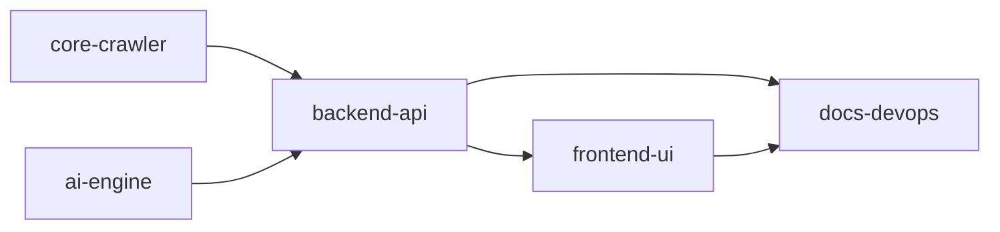

# Capability Map: AI Company Brochure Generator

This document defines the module boundaries, dependencies, and build order for converting the course notebook exercise into a production-ready, fullstack AI web-research and marketing brochure generator.

## Module Directory & Responsibilities

| Module ID | Responsibility | Depends On | Target Location |
|---|---|---|---|
| `core-crawler` | Web scraping, URL normalization, link discovery, HTML cleaning, text extraction, safe truncation | — | `backend/services/crawler.py` |
| `ai-engine` | Gemini LLM integration via `google-genai`, structured prompt templates, intelligent link relevance filtering (JSON output), brochure synthesis tailored by audience (prospects, investors, recruits) | — | `backend/services/ai_engine.py` |
| `backend-api` | FastAPI application, SSE streaming endpoints (`/api/generate/stream`), input validation (Pydantic), error handling & CORS | `core-crawler`, `ai-engine` | `backend/main.py`, `backend/routers/` |
| `frontend-ui` | React + Vite + Tailwind CSS interface, URL input, audience & tone controls, real-time progress stream viewer, rich Markdown brochure renderer, export options (Markdown, PDF, Clipboard) | `backend-api` (API contract) | `frontend/` |
| `docs-devops` | SDD documentation, system architecture ADRs, developer setup instructions, API schema, test suites | All modules | `docs/`, `tasks/`, `README.md` |

## Build Order

1. **`core-crawler`**: Robust scraping, relative-to-absolute URL resolution, HTML cleanup without notebook limitations.
2. **`ai-engine`**: Prompt design and structured output for link relevance selection and multi-audience brochure generation using Gemini 2.5/Flash.
3. **`backend-api`**: FastAPI service orchestrating crawler and AI engine with Server-Sent Events (SSE) for granular step progress and token streaming.
4. **`frontend-ui`**: Modern React dashboard offering real-time visual progress, brochure preview, and export capabilities.
5. **`docs-devops`**: Comprehensive documentation, unit/integration tests, and environment configurations.
