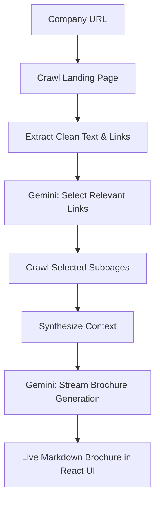

# AI Company Brochure Generator 🚀

An intelligent web-research and marketing brochure generator powered by Google Gemini. This application transforms any company website into polished marketing collateral tailored for prospects, investors, or talent recruiters.

Built following the **Spec-Driven Development (SDD)** framework, evolving from a single Jupyter notebook into an asynchronous, fullstack application with real-time streaming.

---

## 📖 SDD Documentation Index

This project adheres strictly to the SDD (Spec-Driven Development) methodology:

1. [**Capability Map (`CAPABILITY-MAP.md`)**](CAPABILITY-MAP.md): Phase 0 module boundaries, responsibilities, and build order.
2. [**Specification (`SPEC.md`)**](SPEC.md): Phase 1 complete specification covering tech stack, interfaces, boundaries, code conventions, and testing strategies.
3. [**Implementation Plan (`tasks/plan.md`)**](tasks/plan.md): Phase 2 phased technical roadmap and sequence diagrams.
4. [**Task Checklist (`tasks/todo.md`)**](tasks/todo.md): Phase 3 actionable task breakdown with verification criteria.
5. [**Architecture Guide (`docs/architecture.md`)**](docs/architecture.md): Deep-dive into architecture, data flow, and differences from the notebook prototype.
6. [**API Specification (`docs/api.md`)**](docs/api.md): Endpoints, SSE streaming contract, and payload schemas.

---

## ⚡ How It Works



1. **Intelligent Crawling**: Fetches the company's landing page, strips scripts/stylesheets, and discovers internal links while normalizing relative URLs.
2. **AI-Powered Relevance Filtering**: Gemini assesses candidate links (e.g. *About*, *Pricing*, *Careers*, *Team*) to select the 2–4 most valuable pages for the brochure.
3. **Multi-Page Synthesis**: Crawls selected subpages concurrently and combines the full context.
4. **Tailored Generation & Real-Time Streaming**: Generates a rich, structured brochure customized for the target audience (*Prospects*, *Investors*, *Candidates*, or *General*) and streams tokens directly to the browser via Server-Sent Events (SSE).
5. **Interactive UI**: View live progress, inspect selected links, render formatted Markdown, and export to Markdown or PDF.

---

## 🛠️ Tech Stack

- **Backend**: Python 3.12, FastAPI, Uvicorn, Google GenAI SDK (`google-genai`), `httpx`, `BeautifulSoup4`, `pydantic`.
- **Frontend**: React 18, Vite, TypeScript, Tailwind CSS, Lucide Icons, `react-markdown`.
- **Testing**: `pytest`, `pytest-asyncio`.

---

## 🚀 Quickstart Guide

### 1. Prerequisites
- Python 3.10+
- Node.js 18+ and npm
- A Google Gemini API key ([Google AI Studio](https://aistudio.google.com/))

### 2. Configure Environment
Copy `.env.example` to `.env` and insert your Gemini API key:
```bash
cp .env.example .env
```
Edit `.env`:
```env
GEMINI_API_KEY=your_gemini_api_key_here
```

### 3. Backend Setup
```bash
# Create and activate virtual environment
python3 -m venv .venv
source .venv/bin/activate

# Install backend dependencies
pip install -r backend/requirements.txt

# Start FastAPI server
uvicorn backend.main:app --reload --port 8000
```
Backend API will be accessible at `http://localhost:8000` with interactive Swagger docs at `http://localhost:8000/docs`.

### 4. Frontend Setup
```bash
cd frontend
npm install
npm run dev
```
Frontend will be running at `http://localhost:5173`.

---

## 🧪 Running Tests
```bash
# Run backend unit and integration tests
pytest tests/ -v
```
