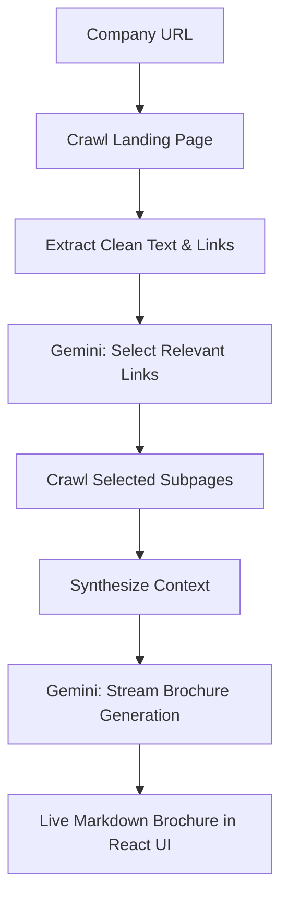
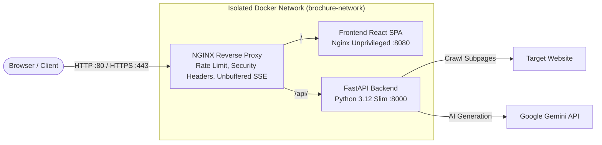

# AI Company Brochure Generator 🚀

[](https://github.com/fededlV/brochure-generator-llm/actions/workflows/ci.yml)


An intelligent, production-ready marketing brochure generator powered by Google Gemini. This application autonomously crawls target company websites, filters high-signal pages with AI reasoning, synthesizes brand context, and streams custom marketing brochures tailored for prospects, investors, or talent recruiters.

Built following the **Spec-Driven Development (SDD)** framework, evolving from a single Jupyter prototype into a fully containerized, secure, asynchronous fullstack application.

---

## ✨ Key Features

- ⚡ **Real-Time Token Streaming**: Server-Sent Events (SSE) pipeline with unbuffered proxying for instant, typewriter-style brochure rendering.
- 🧠 **AI-Powered Link Filtering**: Intelligently scores and filters subpages (About, Pricing, Careers, Products) using structured JSON schemas.
- 🛡️ **SSRF-Protected Crawler**: Hardened asynchronous crawling engine preventing internal IP probing, private subnet traversal, and protocol abuse.
- 🎯 **Audience-Tailored Generation**: Custom synthesis profiles for *Customers & Prospects*, *Investors*, *Job Candidates*, or *General Audience*.
- 🔒 **Zero-Root Container Architecture**: Multi-container Docker deployment running completely rootless (`UID 1001` & `UID 101`) behind an unprivileged NGINX reverse proxy.
- 📄 **Interactive Export**: Live Markdown rendering with syntax highlighting, one-click clipboard copy, and print-ready PDF export.
- 🧪 **Comprehensive Test Suite**: 24 automated unit and integration tests with mocked LLM APIs via `pytest` and `respx`.

---

## 📖 SDD Documentation Index

This project adheres strictly to the SDD (Spec-Driven Development) methodology:

1. [**Capability Map (`CAPABILITY-MAP.md`)**](CAPABILITY-MAP.md): Phase 0 module boundaries, responsibilities, and build order.
2. [**Specification (`SPEC.md`)**](SPEC.md): Phase 1 complete specification covering tech stack, interfaces, boundaries, code conventions, and testing strategies.
3. [**Architecture Guide (`docs/architecture.md`)**](docs/architecture.md): Deep-dive into architecture, data flow, and differences from the notebook prototype.
4. [**API Specification (`docs/api.md`)**](docs/api.md): Endpoints, SSE streaming contract, and payload schemas.

---

## ⚡ How It Works



1. **Intelligent Crawling**: Fetches the company's landing page, strips scripts/stylesheets, and discovers internal links while normalizing relative URLs.
2. **AI-Powered Relevance Filtering**: Gemini assesses candidate links (e.g. *About*, *Pricing*, *Careers*, *Team*) to select the 2–4 most valuable pages for the brochure.
3. **Multi-Page Synthesis**: Crawls selected subpages concurrently and combines the full context.
4. **Tailored Generation & Real-Time Streaming**: Generates a rich, structured brochure customized for the target audience (*Prospects*, *Investors*, *Candidates*, or *General*) and streams tokens directly to the browser via Server-Sent Events (SSE).
5. **Interactive UI**: View live progress, inspect selected links, render formatted Markdown, and export to Markdown or PDF.

---

## 🛠️ Tech Stack

- **Backend**: Python 3.12, FastAPI, Uvicorn, Google GenAI SDK (`google-genai`), `httpx`, `BeautifulSoup4`, `pydantic`.
- **Frontend**: React 18, Vite, TypeScript, Tailwind CSS, Lucide Icons, `react-markdown`.
- **Testing**: `pytest`, `pytest-asyncio`.

---

## 🐳 Production Deployment with Docker Compose & NGINX

The project includes production-grade container orchestration powered by Docker, Docker Compose, and a dedicated NGINX reverse proxy gateway.

### Architecture Overview



### 1. Configure Environment
Copy `.env.example` to `.env` and insert your Gemini API key:
```bash
cp .env.example .env
```
Edit `.env`:
```env
GEMINI_API_KEY=your_gemini_api_key_here
GEMINI_MODEL=gemini-3.5-flash-lite
HTTP_PORT=80
HTTPS_PORT=443
```

### 2. Start Services
Build and start all services in detached mode:
```bash
docker compose up -d --build
```

Access the application:
- **Web Interface**: `http://localhost/` (or port configured in `HTTP_PORT`)
- **API Health**: `http://localhost/api/health`
- **Interactive Swagger Docs**: `http://localhost/docs`

### 3. Service Management Commands
```bash
# View service statuses & health
docker compose ps

# View live container logs
docker compose logs -f

# Gracefully stop the application
docker compose down
```

---

## 🔒 Security Best Practices Implemented

1. **Defense-in-Depth Network Isolation**:
   - Only the NGINX reverse proxy binds to host ports (`80` and `443`).
   - The FastAPI backend and React frontend are quarantined inside an isolated bridge network (`brochure-network`) with no direct public host exposure.

2. **Least Privilege & Non-Root Execution**:
   - **Backend**: Runs as unprivileged system user `appuser` (UID 1001, GID 1001).
   - **Frontend & Proxy**: Run on `nginxinc/nginx-unprivileged:alpine` as non-root user `nginx` (UID 101) binding to unprivileged ports (`8080` / `8443`).
   - All containers have `no-new-privileges:true` and `cap_drop: [ALL]` enabled.

3. **Exchange Security & Hardened HTTP Headers**:
   - `X-Frame-Options: DENY` (Clickjacking mitigation)
   - `X-Content-Type-Options: nosniff` (MIME-sniffing prevention)
   - `X-XSS-Protection: 1; mode=block`
   - `Referrer-Policy: strict-origin-when-cross-origin`
   - `Permissions-Policy: camera=(), microphone=(), geolocation=()`
   - `Content-Security-Policy`: Strictly scoped for React, fonts, and SSE connections.
   - `server_tokens off;` and `proxy_hide_header X-Powered-By`: Prevents version fingerprinting and information disclosure.

4. **Abuse & DoS Mitigation**:
   - `limit_req_zone`: Enforces rate limiting on `/api/*` (10 req/s with burst of 20, returning HTTP 429).
   - `limit_conn_zone`: Restricts concurrent connections per IP.
   - HTTP method whitelisting: Restricts non-standard methods (returns HTTP 405).
   - Payload limit: `client_max_body_size 10M;` to prevent memory exhaustion attacks.

5. **Server-Sent Events (SSE) Optimization**:
   - `/api/generate/stream` is configured with `proxy_buffering off;`, `proxy_cache off;`, and 300s timeouts so tokens stream in real time without lag.

6. **Environment Variable & Secrets Security**:
   - Confidential keys (`GEMINI_API_KEY`) are passed strictly via system environment / `.env`.
   - `.env` and certificate files are blocked via `.gitignore` and `.dockerignore`.
   - No secrets are ever baked into Docker image layers or build cache.

7. **SSL/TLS Readiness**:
   - Certificate templates provided in `nginx/conf.d/default.conf` and `nginx/certs/README.md` with TLSv1.2/1.3 and modern cipher suites.

---

## 💻 Local Development (Without Docker)

### 1. Prerequisites
- Python 3.10+
- Node.js 18+ and npm
- A Google Gemini API key ([Google AI Studio](https://aistudio.google.com/))

### 2. Backend Setup
```bash
# Create and activate virtual environment
python3 -m venv .venv
source .venv/bin/activate

# Install backend dependencies
pip install -r backend/requirements.txt

# Start FastAPI server
uvicorn backend.main:app --reload --port 8000
```
Backend API will be accessible at `http://localhost:8000` with interactive Swagger docs at `http://localhost:8000/docs`.

### 3. Frontend Setup
```bash
cd frontend
npm install
npm run dev
```
Frontend will be running at `http://localhost:5173`.

---

## 🧪 Running Tests
```bash
# Run backend unit and integration tests
pytest tests/ -v
```

---

## 👤 Author & Connect

**Federico de la Vega**
- **GitHub**: [@fededlV](https://github.com/fededlV)
- **LinkedIn**: [Federico de la Vega](https://www.linkedin.com/in/federico-de-la-vega/)

Feedback, stars ⭐, and suggestions are welcome!

---

## 📄 License

This project is licensed under the [MIT License](LICENSE) - see the LICENSE file for details.
