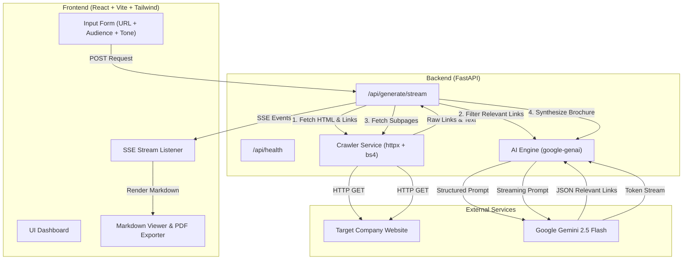

# System Architecture: AI Company Brochure Generator

## Executive Summary
This document outlines the technical architecture of the AI Company Brochure Generator, demonstrating the transformation of an initial exploratory Jupyter Notebook (`week1/day5.ipynb`) into a modular, production-ready fullstack web application.

## High-Level Architecture

## Transformation from Course Notebook to Production

| Aspect | Course Notebook Prototype (`week1/day5.ipynb`) | Production Fullstack Application |
|---|---|---|
| **Execution Model** | Sequential cells in Jupyter Notebook | Asynchronous FastAPI service with non-blocking I/O |
| **User Interface** | Python `display(Markdown(...))` in cell outputs | Responsive React SPA with live token streaming & PDF export |
| **Link Extraction** | Raw `href` attributes without normalization | Resolves relative links to absolute URLs (`urllib.parse.urljoin`), filters fragments & mailto |
| **Link Selection** | Basic prompt with unvalidated text response | Strict JSON structured output with schema validation and fallback |
| **AI Integration** | OpenAI SDK pointing to Gemini base URL | Official Google GenAI SDK (`google-genai`) with native Gemini 2.5 Flash models |
| **Progress Visibility** | Silent cell execution until done | Server-Sent Events (SSE) broadcasting live step progress and streaming tokens |
| **Reliability** | Fails on any single subpage network error | Resilient async scraping with per-subpage timeouts and graceful degradation |
| **Testing** | Manual visual inspection of notebook output | Automated unit and integration test suite (`pytest`) |

## Data Flow Pipeline

1. **URL Ingestion & Validation**:
   - The user inputs a company domain (e.g., `https://huggingface.co`) and selects target audience (`prospects`, `investors`, `candidates`, `general`) and tone (`professional`, `energetic`, `minimalist`).
   - The backend validates the URL format and prevents Server-Side Request Forgery (SSRF) to loopback addresses.

2. **Landing Page Crawling (`CrawlerService`)**:
   - Asynchronously requests the landing page using standard desktop browser headers and a 10s timeout.
   - Decomposes scripts, stylesheets, SVG graphics, forms, and tracking widgets.
   - Extracts page title and clean text content.
   - Discovers all internal and external links, converting relative URLs (e.g. `/about` -> `https://huggingface.co/about`).

3. **Intelligent Link Selection (`AIEngine`)**:
   - The system feeds the landing page summary and candidate internal links to Gemini.
   - Gemini evaluates which 2 to 4 links are most relevant for a company brochure (e.g., *About Us*, *Products*, *Company Mission*, *Careers*, *Pricing*), ignoring irrelevant links like *Terms of Service*, *Cookie Policy*, or *Sign In*.
   - Gemini returns structured JSON containing the chosen URLs and rationale.

4. **Concurrent Subpage Crawling**:
   - The crawler fetches content from the selected links concurrently using `asyncio.gather`.
   - Each page is cleaned, formatted, and capped to avoid context blowup.

5. **Brochure Synthesis & Streaming**:
   - A synthesized context combining landing content and subpage contents is constructed.
   - Gemini streams the multi-section brochure formatted in rich Markdown.
   - Each token chunk is streamed in real time to the browser via SSE.
