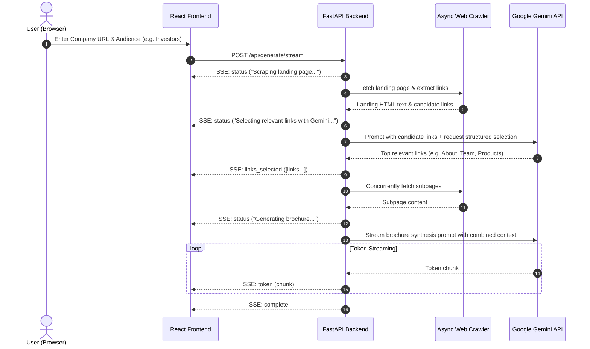

# Implementation Plan: AI Company Brochure Generator

This plan outlines the staged technical execution for converting the notebook prototype into a fullstack web application following Spec-Driven Development.

## Architecture Overview

## Phase Breakdown

### Phase A: Project Setup & Core Crawler (`core-crawler`)
- Establish project directory structure (`backend/`, `frontend/`, `docs/`, `tasks/`).
- Create `backend/requirements.txt` with FastAPI, Uvicorn, google-genai, httpx, beautifulsoup4, lxml, pydantic.
- Implement `backend/services/crawler.py`:
  - URL validation & SSRF protection.
  - Async fetching with headers & timeouts (`httpx.AsyncClient`).
  - Link extraction with relative-to-absolute URL conversion (`urllib.parse.urljoin`).
  - HTML text cleanup (removing scripts, styles, forms, images).
  - Truncation limit management.
- Unit tests for crawler (`tests/test_crawler.py`).

### Phase B: AI Engine with Gemini (`ai-engine`)
- Implement `backend/config.py` using `pydantic-settings` to load and validate `GEMINI_API_KEY` (with fallback to `GOOGLE_API_KEY`).
- Implement `backend/services/prompts.py`:
  - Link filtering prompt (returning strict JSON list of relevant links).
  - Brochure synthesis prompt customized by target audience (`prospects`, `investors`, `candidates`, `general`) and tone (`professional`, `energetic`, `minimalist`).
- Implement `backend/services/ai_engine.py`:
  - Gemini client wrapper using `google-genai`.
  - Structured link selection parsing with robust fallback.
  - Streaming generation generator for brochure text.
- Unit tests for prompts & parsing (`tests/test_ai_engine.py`).

### Phase C: Backend API & SSE Streaming (`backend-api`)
- Implement Pydantic models in `backend/models/`:
  - Request schema (`BrochureRequest`).
  - SSE event payload models (`StatusEvent`, `LinksEvent`, `TokenEvent`, `ErrorEvent`).
- Implement FastAPI endpoint `POST /api/generate/stream` using `StreamingResponse`:
  - Multi-step generator yielding SSE events.
  - Comprehensive error handling and CORS middleware.
  - Health check endpoint `GET /api/health`.
- Integration tests for API & streaming (`tests/test_api.py`).

### Phase D: Frontend Application (`frontend-ui`)
- Initialize Vite + React + TypeScript in `frontend/`.
- Configure Tailwind CSS.
- Build components:
  - `Header`: Clean brand header with subtitle and status badge.
  - `GeneratorForm`: URL input with validation, audience selector pills, tone dropdown, submit button.
  - `StreamProgress`: Visual step-by-step progress indicator and live status log.
  - `BrochureViewer`: Beautiful markdown renderer with typography styles.
  - `ExportActions`: Copy to clipboard, download Markdown, print/export PDF.
- Implement `frontend/src/services/api.ts` SSE consumer with auto-reconnection and error handling.

### Phase E: End-to-End Verification & Documentation (`docs-devops`)
- Create end-to-end user guide and developer documentation in `README.md` and `docs/`.
- Provide environment configuration instructions.
- Verify end-to-end generation with live or mocked website flow.
